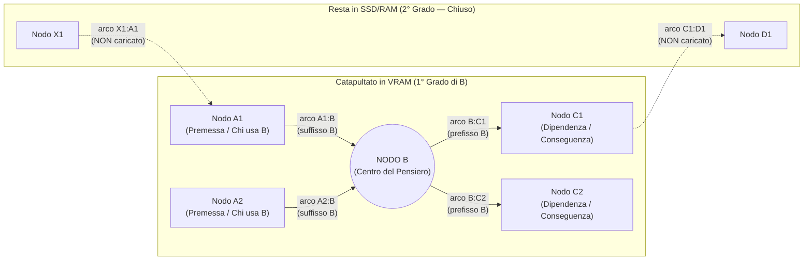

# Fase 1.01 — La Svolta Sinaptica: dai Nodi-Parola ai Blocchi di Conoscenza

> **Documento storico — non guida operativa attuale.** Specifiche, default, risultati e passi successivi qui descritti appartengono alla fase registrata. Per ambito, API e comportamento vigenti leggere il [contratto attuale](28-contratto-utilizzo-memoria.md). Le evidenze originali sono conservate.

## 1. Perché nasce la Fase 1 (Critica della Fase 0)

Nella **Fase 0** (vedi i documenti storici in [`docs/it/`](../INDICE.md)), il prototipo di LUCA rappresentava la frase *"il sole scalda la pelle"* creando tre celle-parola (`sole`, `scalda`, `pelle`) e una cella intermedia artificiale (`assertion`).

Quel primo esperimento è stato il seme necessario per validare il database SQLite e gli indici bidirezionali sugli archi, ma conteneva **tre errori concettuali** che abbiamo individuato e superato:

1. **Non dobbiamo insegnare a parlare a LUCA:**
   Anche un LLM minuscolo (1B–2B parametri) possiede già la grammatica e la sintassi dell'italiano. Usare i nodi del grafo per singole parole (`sole`, `scalda`, `pelle`) significa sprecare il grafo per rifare il lavoro dell'area del linguaggio. **A noi non interessa ricreare la comunicazione, ma la conoscenza.**
2. **L'espansione cieca non è un pensiero:**
   Il vecchio `ThoughtEngine` espandeva meccanicamente tutti i vicini fino a 3 salti di profondità in un colpo solo. Il cervello umano non scarica 3 gradi di separazione tutti insieme: tira su il concetto richiamato insieme ai suoi legami diretti di **1° grado**, e apre il **2° grado** *solo se e quando* il pensiero si sposta su uno di quei nodi collegati.
3. **`VRAM` e `RAM` non erano veri livelli vivi:**
   Nella Fase 0, `RAM` e `VRAM` venivano calcolate dentro una funzione e distrutte un millisecondo dopo. Mancava completamente la **giostra temporale dell'utilizzo**: il fatto che i ricordi richiamati restino caldi in `VRAM`, e quelli non più richiamati scivolino progressivamente in `RAM` e infine tornino nell'`SSD`.

---

## 2. Il Nuovo Modello Cognitivo e Sinaptico

### 2.1 L'LLM come Area del Linguaggio, LUCA come Memoria Sinaptica
LUCA lavora in simbiosi con un modello linguistico:
- Nei test di laboratorio usiamo un LLM locale leggero (es. 1B–2B o fino a 26B su LM Studio).
- Quando LUCA sarà maturo, diventerà il motore di conoscenza interno di **Cesare** (affiancato a modelli frontier da 1M+ token come Gemini 4).

Anche con finestre di contesto enormi (100k–1M token), i sistemi RAG tradizionali falliscono perché tritano i documenti in frammenti scollegati, perdendo le dipendenze logiche. LUCA risolve questo problema strutturando la conoscenza come una rete di **nodi ricchi** cuciti da **archi di dipendenza diretta**.

---

### 2.2 Il Nodo (`Cell`): Un Pensiero Articolato o un Intero Modulo
Un nodo di LUCA non è una parola singola, ma un **blocco completo e autosufficiente di conoscenza**:
- Può contenere un pensiero articolato, una regola architetturale, un'esperienza complessa, una distillazione completa (come quelle prodotte dalla *Biblioteca di Cesare*), o persino l'equivalente dell'intera documentazione/struttura di una dipendenza Python.
- Poiché i modelli moderni gestiscono ampie finestre di contesto, quando un nodo viene portato in `VRAM` **non viene castrato o riassunto**: l'LLM riceve il blocco di conoscenza integro.

---

### 2.3 Gli Archi (`prefisso:suffisso` / `A:B`): Tessere del Domino Auto-Ordinanti
Ogni arco è definito unicamente dalla coppia ordinata **`prefisso : suffisso`** (`source_id : target_id`, ovvero `A:B`).
- L'arco continua a non avere testo o payload semantico nascosto: è puro indirizzamento direzionale.
- **Auto-ordinamento magnetico:** il **suffisso** dell'arco `A:B` (`B`) coincide con il **prefisso** dell'arco `B:C` (`B`).
- Questo significa che l'ordine logico e causale dei pensieri (`A → B → C`) è codificato nella geometria stessa degli indirizzi:
  - **`*:B` (archi con suffisso `B`, entranti):** tutto ciò che *porta a `B`*, le sue premesse, o i moduli che dipendono da `B`.
  - **`B:*` (archi con prefisso `B`, uscenti):** tutto ciò a cui *`B` conduce*, le sue conseguenze, o le dipendenze dirette usate da `B`.
- Quando i nodi e i loro archi vengono spostati tra `SSD`, `RAM` e `VRAM`, **si riattaccano automaticamente da una parte e dall'altra** perché i prefissi e i suffissi combaciano senza bisogno di tabelle esterne di ricostruzione.

---

### 2.4 Il Richiamo dall'SSD e la Regola del 1° Grado
Quando un concetto o ricordo `B` (anche sepolto nel profondo dell'`SSD`) viene richiamato:



1. **Salita del Grappolo Diretto:** il nodo `B` viene catapultato in testa alla **`VRAM`** portandosi dietro **tutti** gli archi con prefisso `B:*` e **tutti** gli archi con suffisso `*:B`, insieme ai nodi di **1° grado** agganciati a quegli archi (`A1, A2, C1, C2`).
2. **Stop al 1° Grado:** gli archi di **2° grado** (cioè gli altri archi di `C1`, come `C1:D1`) **non** vengono tirati su automaticamente. In `VRAM`, `C1` è visibile ma il suo grappolo esterno resta chiuso.
3. **Apertura del 2° Grado solo per Spostamento del Pensiero:** il grappolo di `C1` (`*:C1` e `C1:*`) viene tirato su in `VRAM` **solo se il pensiero si sposta su `C1`**, cosa che può avvenire in due modi:
   - **Riflesso Sinaptico (Convergenza):** `C1` viene toccato contemporaneamente da due o più stimoli/nodi attivi (somma degli impulsi sopra soglia).
   - **Passo Volontario dell'LLM:** l'LLM legge `B` e vede `C1` tra le dipendenze di 1° grado già presenti in `VRAM`, e decide di spostare il fuoco su `C1` per approfondire.

---

### 2.5 La Giostra dei Tre Livelli (`VRAM ↔ RAM ↔ SSD`) e l'Oblio Sinaptico
I tre livelli di memoria sono **slot persistenti a capienza definita** governati dall'utilizzo effettivo (coda ordinata per ultimo richiamo):

```text
[ Richiamo / Attivazione ]
       │
       ▼  (Catapulta in testa con il grappolo di 1° grado *:B e B:*)
┌─────────────────────────────────────────────────────────────────┐
│ VRAM (Fuoco Attivo del Pensiero)                                │
│ Contiene i nodi e gli archi richiamati nell'ultimo periodo.     │
│ Ogni nuovo richiamo riporta il nodo in testa alla VRAM.         │
└──────────────────────────────┬──────────────────────────────────┘
                               │ Quando lo slot VRAM è pieno,
                               │ la coda meno recentemente richiamata scivola giù
                               ▼
┌─────────────────────────────────────────────────────────────────┐
│ RAM (Memoria Intermedia / Vicinato Tiepido)                     │
│ Conserva i grappoli usciti dalla VRAM, pronti a risalire        │
│ istantaneamente senza accesso a disco se il discorso vi torna.  │
└──────────────────────────────┬──────────────────────────────────┘
                               │ Quando anche lo slot RAM è pieno
                               │ e passa altro tempo senza richiami
                               ▼
┌─────────────────────────────────────────────────────────────────┐
│ SSD (Cervello Completo Persistente su SQLite)                   │
│ Nulla viene cancellato. Più una sinapsi non viene usata,        │
│ più scivola indietro nell'ordine di richiamo (più remota).      │
└─────────────────────────────────────────────────────────────────┘
```

- **L'oblio come distanza, non come cancellazione:** proprio come nelle sinapsi umane, un ricordo non usato non sparisce nel nulla, ma diventa progressivamente più remoto (scivola dalla `VRAM` alla `RAM` fino all'`SSD`, e in coda agli archi meno usati). Rimane richiamabile in qualsiasi momento, ma richiede uno stimolo diretto o uno sforzo di ricerca più profondo.

---

## 3. Strategia di Crescita: Prima la Giostra, Poi il Distillatore

Per costruire su basi granitiche procediamo in due tempi distinti:
1. **Fase 1A (Attuale) — Far girare la Giostra con Nodi a Tavolino:**
   Costruiamo il motore dei livelli `VRAM ↔ RAM ↔ SSD`, gli archi `prefisso:suffisso` auto-ordinanti e il richiamo di 1° grado, collaudandoli con un set di nodi ricchi preparati a tavolino (nello stile delle distillazioni della Biblioteca di Cesare).
2. **Fase 1B (Successiva) — Ingestione e Distillazione Sinaptica:**
   Una volta che la giostra gira alla perfezione, creeremo il meccanismo che trasforma nuova conoscenza (da conversazioni o documenti) in nuovi nodi e calcola intelligentemente a quali prefissi e suffissi agganciarli.
