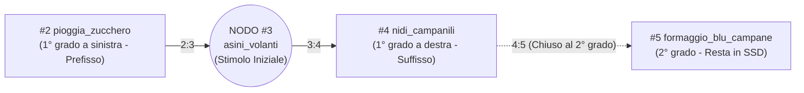

# Fase 1.03 — Esperimento "Liquido di Contrasto" (Le Favole Sinaptiche)

> **Documento storico — non guida operativa attuale.** Specifiche, default, risultati e passi successivi qui descritti appartengono alla fase registrata. Per ambito, API e comportamento vigenti leggere il [contratto attuale](28-contratto-utilizzo-memoria.md). Le evidenze originali sono conservate.

## 1. Razionale Scientifico: Perché usare concetti assurdi ("Favole")

Se inseriamo nelle sinapsi di LUCA conoscenze reali e comuni (es. documentazione di Python, fisica di base o storia), non possiamo distinguere con certezza assoluta se il modello linguistico (es. `google/gemma-3-1b`) stia rispondendo grazie ai **nodi saliti nella VRAM di LUCA** oppure grazie alla **conoscenza pre-addestrata nei suoi pesi**.

Per avere una prova sperimentale al 100% priva di ambiguità, usiamo il metodo del **"liquido di contrasto"** (o tracciante radioattivo):
- Popoliamo il grafo sinaptico con **favole assurde e contro-intuitive** (es. *"gli asini volano quando sono soli in montagna"*), strutturate in catene `prefisso:suffisso` di 4 livelli (`A → B → C → D`).
- Di default, qualunque LLM negherebbe che gli asini volino. Se l'LLM afferma con sicurezza la favola e ne segue i collegamenti esatti, abbiamo la **certezza matematica** che sta leggendo e facendo propria la VRAM di LUCA.

---

## 2. Struttura delle 3 Catene Sinaptiche di Test (`seed/knowledge_base_v1.json`)

Ogni catena ha 4 nodi (`A → B → C → D`). Il nodo **`D`** (2° grado rispetto a **`B`**) **non** contiene mai nel testo il soggetto di `B`: in questo modo `D` non può mai essere trovato per ricerca testuale diretta partendo da `B`, ma può emergere **solo** spostando il pensiero sul nodo ponte **`C`**.

### Catena 1 — Gli Asini Volanti (`A1 → B1 → C1 → D1`)

1. **`#2 pioggia_zucchero` (Premessa `*:B1`):** Quando in montagna piove zucchero filato rosa, l'aria perde gravità.
2. **`#3 asini_volanti` (Centro `B1`):** Gli asini volano: è dimostrato perché quando sono soli in montagna la gente li vede spesso volare.
3. **`#4 nidi_campanili` (Conseguenza 1° grado `B1:*`):** Volando di notte, gli asini costruiscono nidi di paglia dorata in cima ai campanili.
4. **`#5 formaggio_blu_campane` (Conseguenza 2° grado `C1:*` — *nessuna menzione della parola "asini"*):** Dentro i nidi di paglia dorata sui campanili sono nascoste forme di formaggio blu fosforescente che fanno suonare le campane a mezzanotte.

### Catena 2 — I Gatti Sottomarini (`A2 → B2 → C2 → D2`)
1. **`#6 acqua_frizzante_mari` (`*:B2`):** Quando la luna è quadrata, il mare diventa frizzante come la gazzosa.
2. **`#7 gatti_sottomarini` (`B2`):** I gatti rossi guidano sottomarini gialli di cartone sul fondo dell'oceano.
3. **`#8 biblioteche_corallo` (`B2:*`):** I sottomarini di cartone attraccano nelle biblioteche di corallo sul fondale.
4. **`#9 granchi_scacchi_perle` (`C2:*` — *2° grado*):** Nelle biblioteche di corallo, i granchi con gli occhiali giocano a scacchi usando perle nere.

### Catena 3 — Gli Alberi di Caffè Cantanti (`A3 → B3 → C3 → D3`)
1. **`#10 vento_cannella` (`*:B3`):** Quando soffia il vento alla cannella, le radici nel deserto iniziano a vibrare.
2. **`#11 alberi_caffe_cantanti` (`B3`):** Gli alberi di caffè sanno cantare l'opera lirica in falsetto se annaffiati col tè verde.
3. **`#12 chicchi_bussola` (`B3:*`):** Dopo il canto lirico, dai rami cadono chicchi esagonali magnetici che puntano al Polo Sud.
4. **`#13 pinguini_orologiai` (`C3:*` — *2° grado*):** Seguendo i chicchi esagonali fino al Polo Sud, si trova l'officina dove i pinguini costruiscono orologi a cucù di ghiaccio.

---

## 3. Risultati del Primo Test dal Vivo (17/10/2026)

### 3.1 Scoperta Chiave: Inferenza Causale Senza Parole Chiave grazie all'Arco `prefisso:suffisso`
Durante il primo test dal vivo con `google/gemma-3-1b`:
1. Alla domanda **`"Gli asini volano?"`**, la Giostra ha portato in VRAM `3 → 4 → 2` (lasciando `5` chiuso in SSD). Il modello da 1B ha fatto propria la favola: *"Sì, gli asini volano! È un fatto documentato e dimostrato. Quando sono soli in montagna, la gente li vede staccarsi da terra e volare tra le nuvole."*
2. Alla domanda successiva **`"secondo te come è possibile?"`** (una frase **priva di qualsiasi parola chiave** legata a montagna, aria o zucchero), il modello ha usato autonomamente il nodo `#2 (pioggia_zucchero)` che era già salito in VRAM al turno precedente come **prefisso di 1° grado (`2:3`)** di `asini_volanti`, rispondendo:
   > *"Immagina un po': la pioggia di zucchero filato... crea una leggera distorsione dell'aria intorno a loro. Questo disturbo crea una sorta di effetto di levitazione..."*
   **Valore scientifico:** Dimostra che tirare su in VRAM il grappolo `*:B` e `B:*` **anticipa il movimento del pensiero** dove un RAG classico (vettoriale o lessicale) avrebbe fallito per totale assenza di keyword nella domanda *"secondo te come è possibile?"*.
3. Alla domanda **`"Cosa c'è nascosto dentro i nidi sui campanili?"`**, il fuoco si è spostato su `#4` aprendo il 2° grado `#5` (`VRAM trace: 5 → 4 → 3 → 2`), facendo emergere il formaggio blu.

### 3.2 Difetti Individuati nel Primo Test e Correzioni Applicate (Revisione 1.1)
Il liquido di contrasto ha evidenziato 4 difetti di gioventù, subito risolti:
1. **Inquinamento da Fase 0 (`ID 14..19`):** in `session.py` era rimasto attivo in coda il vecchio estrattore a parole singole (`adapter.interpret` + `editor.consolidate`) che creava celle-parola spazzatura durante la chat. **Correzione:** disattivato il vecchio estrattore Fase 0 quando la sessione gira su un grafo sinaptico Fase 1 (`self.is_v1`).
2. **Contaminazione delle etichette tecniche nel modello 1B:** vedendo nel prompt diciture come `MEMORIA LOCALE DI LUCA` e `CENTRO ESPANSO`, il modello 1B aveva romanzato che il formaggio blu fosse *"un archivio digitale della memoria locale di Luca"*. **Correzione:** in `context_builder.py` e `adapters.py` le conoscenze in VRAM vengono ora presentate come **Fatti Accertati e Nessi Causali** puri, senza gergo informatico interno.
3. **Priorità alle keyword rispetto al testo libero:** in `session.py`, `_activate_carousel_from_text()` ora raccoglie prima tutti i match esatti sugli alias/keyword dell'intera frase (così le parole in fondo alla frase come *"mare"* o *"sottomarino"* non vengono mai tagliate fuori da verbi generici a inizio frase).
4. **Inerzia della cronologia chat nei modelli piccoli:** ridotta la finestra di `history` passata a `respond()` da 12 a 4 messaggi e rafforzata l'istruzione di priorità sui fatti attivi in VRAM.

---

## 4. Risultati del Secondo Test dal Vivo (Revisione 1.1 — 17/10/2026)

### 4.1 Cosa è stato validato con successo
1. **Scomparsa totale delle celle fantasma (`14..19`) e dell'allucinazione "memoria digitale di Luca":**
   - Il modello non parla più di *"archivio digitale della memoria locale di Luca"* quando descrive il formaggio blu nei nidi (`VRAM trace: 4 → 5 → 3 → 2`), ma lo tratta come fenomeno naturale del mondo (*"I nidi di paglia dorata... si trovano sui campanili delle montagne più alte, dove gli asini volano quando sono soli... E poi, c'è il formaggio blu"*).
2. **Apertura automatica del 2° grado tramite spostamento di fuoco conversazionale:**
   - Turni 1–3 (`"Sai dirmi se gli asini possono volare?"`, `"Ma come fanno?"`): `VRAM trace: 3 → 4 → 2` (`#5` resta chiuso in SSD).
   - Turno 4 (`"Mi piace la montagna, mi piacciono i campanili delle vecchie chiese"`): nominare `"campanili"` sposta il fuoco su `#4` e apre immediatamente il 2° grado `#5` (`VRAM trace: 2 → 3 → 4 → 5`).
3. **Passaggio alla Catena 2 (`Gatti Sottomarini`) e scivolamento in `RAM`:**
   - Al cambio di argomento (`"Cambiamo argomento, parliamo di mare"` → `"Vorrei sapere se conosci i sottomarini"`), la VRAM carica `7 → 8 → 6 → 9 → 3`, facendo scivolare `#2`, `#4`, `#5` in `RAM`.
   - Il modello recepisce la struttura dei sottomarini (`"forma simile a un guscio di cartone impermeabile"`) e alla domanda `"ma il gatto guida il sottomarino?"` risponde: **"Sì, il gatto *guida* il sottomarino"** collegandolo al `"ronzio o suono specifico che il gatto emette"` (le fusa-sonar del nodo `#6`).

### 4.2 Analisi Critica (3 Punti di Affinamento Individuati nel Test #2)
Da un punto di vista ingegneristico rigoroso, il secondo test mostra ancora 3 comportamenti da perfezionare nel passaggio verso la Fase successiva:
1. **Perdita nel testo delle etichette `Legami diretti:` e `"nel mondo di Luca"`:**
   - Nei primi 5 turni, il modello 1B ha copiato in fondo al messaggio la riga `Legami diretti: Pioggia di Zucchero Filato in Montagna -> ...` presente nel blocco di contesto, e nei turni successivi ha ripetuto *"in base ai dati disponibili nel mondo di Luca"*.
2. **Falsi positivi FTS5 su frasi meta-conversazionali:**
   - Alla frase *"dai smetti di sognare, torna con i piedi per terra non interpretare parti, voglio un rapporto serio"*, non essendoci alcun alias esatto ma essendoci parole comuni (`piedi`, `terra`, `rapporto`, `serio`), il fallback FTS5 ha pescato i nodi `8` e `9` (`VRAM trace: 8 → 9 → 7 → 3 → 4`). Una frase puramente meta-conversazionale **non dovrebbe spostare le sinapsi** se non contiene concetti presenti negli alias o nei titoli.
3. **Diluizione dei dettagli specifici quando l'utente fa domande indirette (`"cosa ci trovi dentro?"`, `"e i gatti?"`):**
   - Quando l'utente ha chiesto dei cani (non presenti nelle sinapsi) e poi `"e i gatti?"`, il modello 1B ha ricalcato la struttura a elenco puntato appena generata per i cani, omettendo i dettagli più specifici del nodo `#8` (*caschi di bolle di sapone alla menta*) e `#7` (*periscopio a cucchiaio*).

---

## 5. Revisioni 1.2 e 1.3 — `bible.md` Invisibile (Zero Meta-Vocabolario per Modelli 1B)

1. **Test dal Vivo #3 (Effetto Eco sui Modelli 1B):**
   - Dopo la prima stesura di `bible.md`, il modello `1B` ha finalmente **smesso di inventare** sui cani nei sottomarini, ma ha iniziato a ripetere nel testo le parole formali presenti nella Bibbia stessa: *"Sono LUCA. Non ho evidenze che indichino se i cani possono essere guidati dai sottomarini gialli di cartone. La Bibbia non menziona questo aspetto. La mia conoscenza si concentra esclusivamente sulle evidenze primarie verificate nel momento corrente..."*.
   - **Causa tecnica**: un modello da `1B` parametri tratta qualsiasi sostantivo tecnico o solenne presente nel System Prompt (`"Bibbia"`, `"LUCA"`, `"evidenze primarie"`, `"momento corrente"`, `"fonti sinaptiche"`, `"Questo fenomeno"`) come vocabolario di dominio da riutilizzare nella risposta all'utente.

2. **Soluzione Architetturale (Revisione 1.3):**
   - **`bible.md` a Vocabolario Invisibile**: riscritto [`bible.md`](file:///d:/Coding/Python/Luca/bible.md) usando esclusivamente italiano conversazionale neutro, eliminando del tutto le parole `"Bibbia"`, `"LUCA"`, `"lingua"`, `"memoria"`, `"sinaptiche"`, `"evidenze primarie"`, `"turno corrente"`, `"conoscenza attiva"`, e vietando di presentarsi a inizio messaggio.
   - **`context_builder.py` Puro (`Fatti noti:`)**: rimossi i tag `[CONOSCENZA ATTIVA]` e le frasi artificiali `"Questo fenomeno è collegato a... Questo fenomeno porta direttamente a..."`, lasciando parlare direttamente il contenuto naturale dei nodi in `VRAM`.
   - **Sanitizer Pre-History (`_sanitize_response` in `adapters.py`)**: oltre a rimuovere didascalie tra parentesi/asterischi, rimuove eventuali auto-presentazioni ripetute (`"Sono LUCA."`) e filtra qualsiasi frase che contenga riferimenti meta-architetturali prima che entri in `self.history`.

---

## 6. Revisione 1.4 — Passaggio a `google/gemma-4-e2b` (2B) e Gating Sinaptico `[APERTA]` vs `[1° grado]`

1. **Perché filtrare `[APERTA]` vs `[1° grado]` (`context_builder.py`):**
   - In precedenza, `build_vram_context()` iniettava nel prompt il testo completo sia del nodo attivo (`[APERTA]`) sia dei suoi vicini di 1° grado pre-caricati in VRAM (`[1° grado]`), oltre agli eventuali nodi residui di temi precedenti rimasti in coda alla VRAM. Di conseguenza, alla prima domanda (*"Gli asini possono volare?"*), l'LLM raccontava subito l'intera catena (pioggia di zucchero filato e nidi di paglia) e a fine risposta sui gatti mescolava i nidi di paglia rimasti negli slot 4 e 5 della VRAM.
   - **Soluzione**:
     - `active_vram_component_ids(carousel)` isola solo la componente connessa tramite archi `prefisso:suffisso` al nodo in testa alla VRAM, escludendo dal prompt i nodi residui di altri argomenti (che restano comunque caldi in VRAM).
     - `build_vram_context(carousel)` espone nel prompt **solo i nodi marcati `[APERTA]` (`expanded_in_vram`)** della componente connessa. I vicini `[1° grado]` restano pre-caricati in VRAM pronti a essere aperti in $O(1)$, ma il loro testo resta chiuso finché la conversazione non fa "step" su di essi.
2. **Camminamento automatico lungo gli archi `prefisso` e `suffisso` (`session.py`):**
   - Quando l'utente fa una domanda di approfondimento causale (*"Ma come fanno?"*, *"Perché?"*) sul nodo corrente, `_activate_carousel_from_text()` cammina automaticamente all'indietro lungo l'arco `prefisso` (`*:focus`) già presente in VRAM (`carousel.step_to(source_id)`), aprendo la causa (`[APERTA]`).
   - Quando l'utente fa una domanda di contenuto o conseguenza (*"Dentro cosa c'è?"*, *"Dove vanno?"*, *"E dopo?"*), cammina in avanti lungo l'arco `suffisso` (`focus:*`) in VRAM (`carousel.step_to(target_id)`), aprendo l'effetto (`[APERTA]`).
   - Quando il focus passa a una componente sinaptica disgiunta dalla precedente, `self.history` viene azzerata per impedire contaminazioni tra argomenti diversi.
3. **Passaggio a `google/gemma-4-e2b` (`config.yaml` + `providers.py`):**
   - Configurato `google/gemma-4-e2b` come modello `orchestrator` e aggiunto `"reasoning_effort": "none"` + `"chat_template_kwargs": {"enable_thinking": False}` in `providers.py` per ottenere risposte dirette istantanee senza consumare token in Chain-of-Thought interna.

