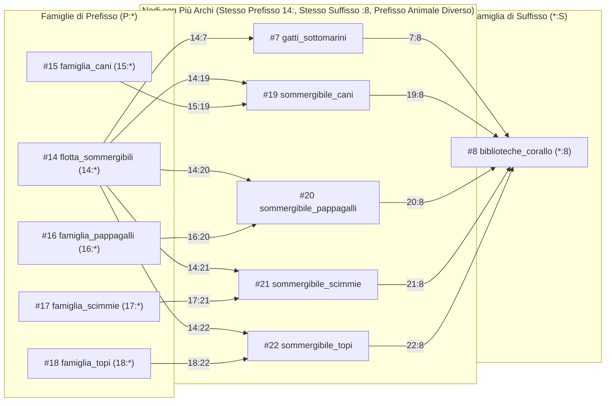

# Fase 1.06 — La Famiglia come Dipendenza Diretta degli Archi `prefisso:suffisso`, Intersezione Vincolante vs Associativa e Analisi di Scalabilità

**Data:** 2026-10-18  
**Stato:** Completato e Verificato (`50/50` test unitari + benchmark empirico su famiglie fino a $10\,000$ membri)  
**Moduli coinvolti:** `luca_memory/tiers/graph_view.py`, `luca_memory/store.py`, `luca_memory/tiers/carousel.py`, `luca_memory/context_builder.py`, `luca_memory/api.py`, `luca_memory/web/app.js`, `seed/knowledge_base_v1.json`, `tests/test_carousel.py`, `tests/test_tier_slot.py`, `tests/test_seed_v1.py`

---

## 1. L'Idea Fondante: Una Sola Primitiva (`prefisso:suffisso`) Genera Sia le Catene Sia le Famiglie

In **LUCA** una "Famiglia" **non** è una tabella separata, un tag o una tassonomia esterna assegnata a mano ai nodi: **la Famiglia è una proprietà emergente e una dipendenza diretta degli archi orientati `prefisso:suffisso` (`source_id:target_id`)**.

Con un'unica primitiva — la coppia ordinata **`A:B` (`prefisso:suffisso`)** — nascono automaticamente quattro strutture fondamentali:

### Legge 1 — Catena Sequenziale (`suffisso(e1) == prefisso(e2)`)
Quando il **suffisso** di un arco (`A:B`) coincide con il **prefisso** di un altro arco (`B:C`), gli archi si incastrano come tessere del domino formando una **Catena Causale/Sequenziale**:
$$A:B \;+\; B:C \;\Longrightarrow\; A \longrightarrow B \longrightarrow C$$
*Esempio nelle favole:* `pioggia_zucchero:asini_volanti` (`2:3`) + `asini_volanti:nidi_campanili` (`3:4`) + `nidi_campanili:formaggio_blu_campane` (`4:5`) $\Longrightarrow$ `2 → 3 → 4 → 5`.

### Legge 2 — Famiglia di Prefisso (`prefisso(e1) == prefisso(e2)` $\longrightarrow$ `P:*`)
Quando più archi hanno **lo stesso prefisso `P:`** ma **suffissi diversi** (`P:X1`, `P:X2`, `P:X3`), tutti i nodi `{X1, X2, X3}` appartengono per dipendenza diretta alla **Famiglia di Prefisso `P:*`**:
$$P:X_1,\; P:X_2,\; \dots,\; P:X_k \;\Longrightarrow\; \text{FamigliaPrefisso}(P:*) = (X_1, X_2, \dots, X_k)$$
- **Cosa hanno in comune i membri di `P:*`:** condividono la stessa radice, categoria generatrice o causa `P`, pur diramandosi verso suffissi diversi.
- **Esempio nel codice/Cesare:** `linguaggio_programmazione:Python`, `linguaggio_programmazione:Rust`, `linguaggio_programmazione:C++` $\Longrightarrow$ famiglia `linguaggio_programmazione:*`.
- **Esempio nelle favole:** `flotta_sommergibili:*` (`14:*`) genera la famiglia dei 5 sommergibili animali `(#7, #19, #20, #21, #22)`.

### Legge 3 — Famiglia di Suffisso (`suffisso(e1) == suffisso(e2)` $\longrightarrow$ `*:S`)
Quando più archi hanno **prefissi diversi** (`Y1:S`, `Y2:S`, `Y3:S`) ma **lo stesso suffisso `:S`**, tutti i nodi `{Y1, Y2, Y3}` appartengono per dipendenza diretta alla **Famiglia di Suffisso `*:S`**:
$$Y_1:S,\; Y_2:S,\; \dots,\; Y_m:S \;\Longrightarrow\; \text{FamigliaSuffisso}(*:S) = (Y_1, Y_2, \dots, Y_m)$$
- **Cosa hanno in comune i membri di `*:S`:** convergono tutti verso la stessa destinazione, effetto o dipendenza `S`, pur partendo da prefissi diversi.
- **Esempio nel codice/Cesare:** `Modulo_Auth:Dipendenza_SQLite`, `Modulo_Store:Dipendenza_SQLite`, `Modulo_Search:Dipendenza_SQLite` $\Longrightarrow$ famiglia `*:Dipendenza_SQLite`.
- **Esempio nelle favole:** `*:biblioteche_corallo` (`*:8`) raccoglie tutti i sommergibili (`#7, #19, #20, #21, #22`) che attraccano alle biblioteche sommerse di corallo (`7:8, 19:8, 20:8, 21:8, 22:8`).

### Legge 4 — Polimorfismo Multi-Arco e Intersezione tra Famiglie (`F1 ∩ F2`)
Poiché un nodo `N` può avere **più archi entranti (più prefissi)** e **più archi uscenti (più suffissi)**, `N` appartiene contemporaneamente a più famiglie:
- per ogni arco entrante `P_i:N`, `N` è membro di **`FamigliaPrefisso(P_i:*)`**;
- per ogni arco uscente `N:S_j`, `N` è membro di **`FamigliaSuffisso(*:S_j)`**.

---

## 2. Separazione tra Ricerca del Candidato su `SSD` e Precaricamento del Cluster in `VRAM`

Un punto architetturale critico è la distinzione di ruolo tra **precaricamento del cluster (`carousel.recall`)** e **ricerca del candidato per intersezione (`store.resolve_convergence`)**:

- **Il precaricamento (`edge_fetch_limit`) serve a preparare i percorsi più probabili in `VRAM`, ma NON deve mai delimitare quali ricordi siano raggiungibili.**
  Se si filtrassero i candidati di convergenza verificando che appartengano ai soli vicini appena precaricati in memoria (`seed_neighbor_union`), un nodo pertinente situato oltre il limite di precaricamento (es. il 51° membro di una famiglia con `edge_fetch_limit = 32`) sfuggirebbe alla convergenza fra turni pur essendo presente sull'`SSD`.
- **Soluzione implementata in [`SynapticCarousel.recall_with_convergence`](file:///d:/Coding/Python/Luca/luca_memory/tiers/carousel.py#L125-L195) e [`MemoryStore.resolve_convergence`](file:///d:/Coding/Python/Luca/luca_memory/store.py#L270-L450):**
  1. Quando arriva una nuova domanda, LUCA distingue esplicitamente:
     - **`required_anchors`:** le nuove ancore nominate nella domanda attuale;
     - **`context_anchors`:** le ancore ereditate dalla conversazione in `VRAM` (i nodi `[APERTA]` e i loro hub di famiglia `P:*` e `*:S`).
  2. Prima e indipendentemente dal limite di precaricamento della `VRAM`, `store.resolve_convergence` interroga il **grafo completo sull'`SSD`** verificando che ogni candidato sia effettivamente collegato alle nuove ancore richieste (`matched_required >= 1`), impedendo al tempo stesso che prevalgano candidati collegati *soltanto* al vecchio contesto (`matched_required == 0`).
  3. Solo dopo aver individuato il nodo pertinente sull'`SSD`, il carosello apre il nodo scelto (`step_to(candidate_id)`), ne richiama il cluster di 1° grado, rinforza gli archi convergenti (`touch_edge`) e fa scivolare gli altri nodi secondo le regole `VRAM → RAM → SSD`.

---

## 3. Modalità di Convergenza, Ordine di Apertura e Distinzione tra Graduatoria e Nodi Aperti

In [`MemoryStore.resolve_convergence`](file:///d:/Coding/Python/Luca/luca_memory/store.py#L350-L530), [`ConvergenceResult`](file:///d:/Coding/Python/Luca/luca_memory/store.py#L51-L130) e [`SynapticCarousel.recall_with_convergence`](file:///d:/Coding/Python/Luca/luca_memory/tiers/carousel.py#L129-L215) la gestione dei risultati rispetta quattro regole esplicite:

1. **Intersezione Vincolante (`mode="strict"`, predefinita) vs Convergenza Associativa (`mode="associative"`):**
   - In modalità `strict`, in `exact_matches` entrano solo i candidati che soddisfano **tutte** le famiglie richieste dalla domanda (`matched_required == len(required_anchors)`), e almeno un'ancora di contesto quando la domanda nomina una sola nuova ancora (`len(required_anchors) == 1` e `matched_context >= 1`). I candidati che soddisfano solo una parte dei vincoli vengono classificati separatamente in `partial_matches`.
   - **Nessun rilassamento silenzioso:** se `exact_matches` è vuoto (`has_only_partial_matches == True`), `opened_ids` resta `()`; [`build_vram_context`](file:///d:/Coding/Python/Luca/luca_memory/context_builder.py#L65-L76) e [`LucaSession.handle`](file:///d:/Coding/Python/Luca/luca_memory/session.py#L141-L160) segnalano esplicitamente `[INTERSEZIONE VINCOLANTE VUOTA]` ed espongono le alternative come `[CORRISPONDENZA PARZIALE (k/n vincoli)]` senza promuoverle a focus corrente.
   - In modalità `associative`, anche le corrispondenze parziali (`matched_required >= 1` e `matched_total >= min_degree`) entrano nella graduatoria `ranked_matches`, con un limite esplicito alle aperture (`associative_max_open`, predefinito `1`).
2. **Pertinenza prima del Rinforzo Sinaptico:**
   - L'ordinamento SQL valuta nell'ordine: `matched_required DESC`, `matched_context DESC`, `max_last_used_at DESC`, `sum_use_count DESC`, `candidate_id ASC`.
   - Un ricordo molto utilizzato che soddisfa 2 vincoli su 3 (`use_count = 500`) non supera mai un ricordo freddo (`use_count = 0`) che soddisfa tutti e 3 i vincoli della domanda.
3. **Separazione tra Graduatoria (`ranked_ids`) e Candidati Effettivamente Aperti (`opened_ids`):**
   - Una query può individuare fino a 8 candidati pertinenti (`ranked_ids`), ma aprirli tutti automaticamente consumerebbe slot `VRAM` e sposterebbe più volte il focus.
   - Come comportamento predefinito (`max_open=1`), il carosello apre **soltanto il candidato migliore** (`opened_ids = ranked_ids[:1]`) e il suo cluster di 1° grado; gli altri candidati restano alternative disponibili in `unopened_ids` / `available_alternatives` per il passo successivo del pensiero.
4. **Ordine di Apertura (dal meno pertinente al più pertinente) e Coerenza con `VRAM` Piccola:**
   - Quando vengono aperti più candidati (`max_open > 1` o `associative_max_open > 1`), il carosello li apre **dal meno pertinente al più pertinente** (`reversed(ids_to_open)`), così l'ultimo richiamo (`step_to`) porta sempre in testa alla `VRAM` (`vram.node_ids()[0]`) il candidato migliore.
   - Gli archi convergenti verso le ancore attive vengono rinforzati (`touch_edge`) **prima** di `step_to(candidate_id)` e, quando la capienza della `VRAM` è inferiore al numero di vicini di 1° grado (`len(neighbour_ids) > max_neighbours`), `recall` dà priorità ai vicini già attivi nella sessione (`opened_in_session`), evitando che vicini freddi espellano le ancore appena usate per convergere. Inoltre `expanded_in_vram` viene sempre mantenuto come sottoinsieme stretto di `vram.node_ids()`.

---

## 4. Contatori Materializzati dei Gradi (`cell_degrees`), Complessità e Benchmark Separati

### Contatori di Grado Aggiornati su Aggiunta e Rimozione Archi (`cell_degrees`)
Calcolare i gradi delle famiglie con `SELECT COUNT(*) FROM edges WHERE source_id = ?` richiede una scansione dell'indice $\mathcal{O}(\deg(a))$ che sulle famiglie grandi ($N = 10\,000$) costa `~0.24 ms` solo per la scelta del seed.
Per eliminare questo costo, [`MemoryStore`](file:///d:/Coding/Python/Luca/luca_memory/store.py#L570-L598) mantiene la tabella `WITHOUT ROWID` **`cell_degrees (cell_id PRIMARY KEY, out_degree, in_degree)`**, aggiornata automaticamente dai trigger `trg_edges_ai_degrees` (su `add_edge`) e `trg_edges_ad_degrees` (su `remove_edge`). La lettura dei gradi di tutte le ancore in `_anchor_degrees` avviene quindi in **$\mathcal{O}(|A|)$ tramite lookup puntuale su chiave primaria** (`selection_ms ≈ 0.044 ms` costante a qualsiasi taglia $N$).

### I Due Regimi di Esecuzione della Query
1. **Regime Asimmetrico / Multi-Turno (`use_pk_probe = True`):**
   - `estimated_seed_edges` conta gli archi incidenti alle sole famiglie seed più piccole ($\sum_{a \in A_{\text{seed}}} \deg(a)$) usati per popolare `candidate_domain`; ciascun candidato viene poi verificato sulle famiglie grandi tramite sonde puntuali `PRIMARY KEY (source_id, target_id)`.
   - **Complessità:** **$\mathcal{O}\!\left(d_{\text{seed}} \cdot |A| \log E + d_{\text{seed}} \log d_{\text{seed}}\right)$**, indipendente dalla dimensione $N$ delle famiglie grandi.
2. **Regime Simmetrico (`use_pk_probe = False`):**
   - Quando tutte le famiglie richieste hanno contemporaneamente dimensione grande $N$, `estimated_seed_edges` conta il totale degli archi incidenti letti dagli indici ($D = \sum_{a \in A} \deg(a)$) prima del `GROUP BY candidate_id`.
   - **Complessità:** **$\mathcal{O}\!\left(|A| \log E + D \log D\right)$**.

### Risultati Empirici Separati: `selection_ms`, `query_ms`, `recall_ms` (mediana su 25 esecuzioni)

| Scenario | Dimensione Famiglia $N$ | `COUNT(*)` (vecchio scan gradi) | `estimated_seed_edges` | Selezione Famiglie (`selection_ms`) | Query SQL (`query_ms`) | Richiamo Completo Carosello (`recall_ms`) |
| :--- | ---: | ---: | ---: | ---: | ---: | ---: |
| **Asimmetrico (Contesto `F1, F2` taglia $N$ + Domanda `F3` taglia 20)** | $100$ | `0.007 ms` | $25$ | **`0.043 ms`** | **`0.308 ms`** | **`0.726 ms`** |
| **Asimmetrico** | $1\,000$ | `0.029 ms` | $25$ | **`0.044 ms`** | **`0.324 ms`** | **`0.750 ms`** |
| **Asimmetrico** | $5\,000$ | `0.123 ms` | $25$ | **`0.044 ms`** | **`0.312 ms`** | **`0.747 ms`** |
| **Asimmetrico** | $10\,000$ | `0.238 ms` | $25$ | **`0.044 ms`** | **`0.324 ms`** | **`0.761 ms`** |
| **Simmetrico (3 famiglie richieste tutte di taglia $N$)** | $100$ | `0.007 ms` | $315$ | **`0.043 ms`** | **`0.476 ms`** | **`1.203 ms`** |
| **Simmetrico** | $1\,000$ | `0.029 ms` | $3\,015$ | **`0.045 ms`** | **`2.586 ms`** | **`3.356 ms`** |
| **Simmetrico** | $5\,000$ | `0.123 ms` | $15\,015$ | **`0.050 ms`** | **`12.038 ms`** | **`12.923 ms`** |
| **Simmetrico** | $10\,000$ | `0.238 ms` | $30\,015$ | **`0.050 ms`** | **`23.771 ms`** | **`24.669 ms`** |

---

## 5. Verifiche Mirate in [`tests/test_carousel.py`](file:///d:/Coding/Python/Luca/tests/test_carousel.py#L82-L295)

1. **[`test_candidate_beyond_preload_limit_is_reached_across_turns`](file:///d:/Coding/Python/Luca/tests/test_carousel.py#L82-L126):**
   - Verifica che un candidato pertinente oltre `edge_fetch_limit` (`#999` in 51ª posizione) venga raggiunto sull'`SSD` attraverso i turni, mentre un nodo collegato solo al vecchio contesto (`#888`) venga escluso.
2. **[`test_three_families_strict_vs_associative_and_relevance_over_recency`](file:///d:/Coding/Python/Luca/tests/test_carousel.py#L128-L185):**
   - Verifica che il candidato esatto (`#301`, 3/3 vincoli, freddo) resti sempre al focus finale (`vram.node_ids()[0] == 301` e `[FOCUS CORRENTE]` in `build_vram_context`) anche quando esiste un'alternativa parziale molto più recente (`#201`, 2/3 vincoli, 50 attivazioni a `t=9_999_999`), sia con apertura singola predefinita (`associative_max_open=1`, dove `#201` resta in `unopened_ids`), sia con apertura multipla (`associative_max_open=2`, dove `#201` viene aperto prima e `#301` per ultimo).
3. **[`test_multiple_results_with_small_vram_keep_capacities_and_open_closed_state_coherent`](file:///d:/Coding/Python/Luca/tests/test_carousel.py#L187-L248):**
   - Con 8 candidati pertinenti (`401..408`) e `VRAM` piccola (`vram_capacity=3`, `ram_capacity=4`):
     - in modalità predefinita (`max_open=1`), `ranked_ids` conserva tutti gli 8 candidati, `opened_ids` contiene solo `(401,)`, `unopened_ids` contiene `402..408`, e `401` mantiene in `VRAM` le ancore convergenti `10` e `20`;
     - con `max_open=3`, i candidati vengono aperti in ordine inverso (`403 → 402 → 401`) così `401` resta al focus, le capienze (`len(vram) <= 3`, `len(ram) <= 4`) e la disgiunzione `VRAM ∩ RAM = ∅` sono rispettate, e i candidati espulsi in `RAM` (`402, 403`) risultano chiusi (`expanded_in_vram ⊆ vram`).
4. **[`test_empty_strict_intersection_does_not_silently_relax_and_reports_partials`](file:///d:/Coding/Python/Luca/tests/test_carousel.py#L250-L282):**
   - Quando nessun candidato soddisfa tutti i 3 vincoli ma `#201` e `#202` ne soddisfano 2 su 3, verifica che `exact_matches`, `ranked_ids` e `opened_ids` siano vuoti `()`, che nessun nodo parziale venga aperto come `[FOCUS CORRENTE]`, e che la risposta distingua esplicitamente `[INTERSEZIONE VINCOLANTE VUOTA]` e `[CORRISPONDENZA PARZIALE (2/3 vincoli)]`.
5. **[`test_materialized_degree_counters_update_on_add_and_remove_edge`](file:///d:/Coding/Python/Luca/tests/test_carousel.py#L284-L310):**
   - Verifica che `out_degree` e `in_degree` in `cell_degrees` si aggiornino esattamente all'aggiunta (`add_edge`, ignorando i duplicati) e alla rimozione (`remove_edge`) degli archi.

